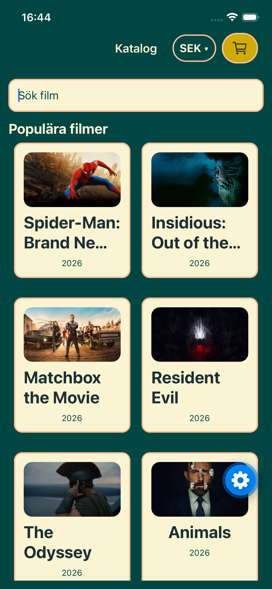
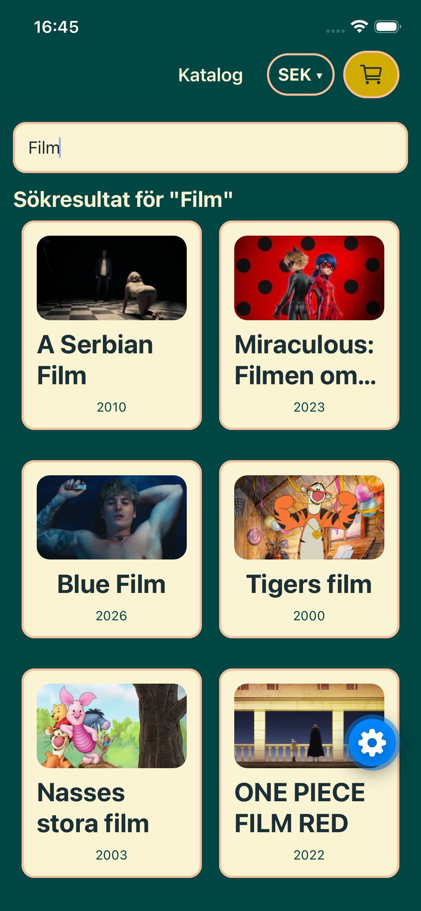
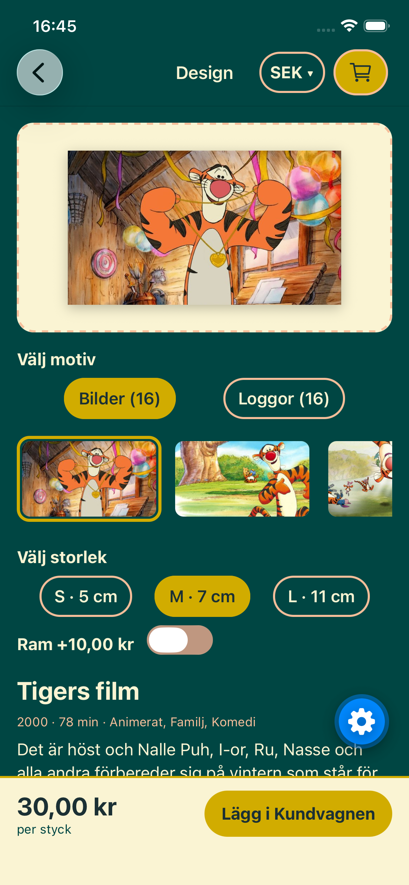
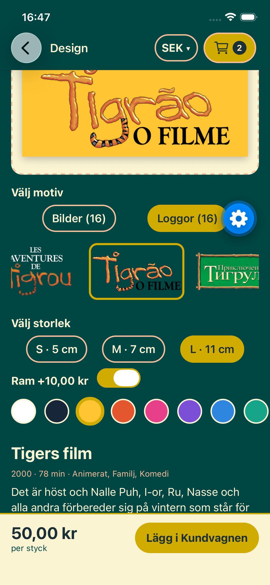
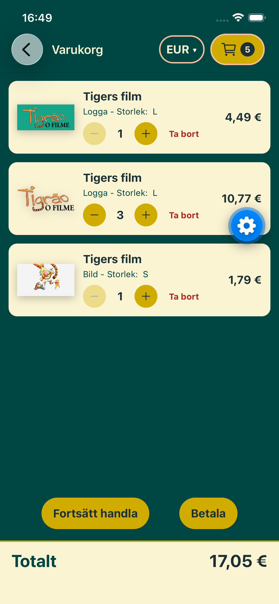
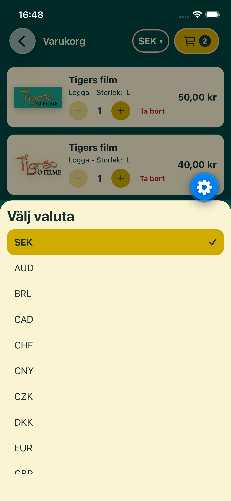

# Stickerstore

Stickerstore är en mobilapp där du gör egna klistermärken av dina favoritfilmer. Sök bland filmer från TMDb, välj en bakgrundsbild eller filmens logga som motiv, välj storlek och ram, och lägg märket i kundvagnen. Priserna kan visas i valfri valuta via Frankfurter, och kundvagnen och valt valutaval sparas lokalt.

Byggd med Expo, React Native, TypeScript och Redux Toolkit.

---

## Skärmbilder

<table>
  <tr>
    <td align="center"></td>
    <td align="center"></td>
    <td align="center"></td>
  </tr>
  <tr>
    <td align="center"><b>Katalog</b><br>Populära filmer i två kolumner</td>
    <td align="center"><b>Sök</b><br>Uppdateras när du slutat skriva</td>
    <td align="center"><b>Design</b><br>Motiv, storlek och ram</td>
  </tr>
  <tr>
    <td align="center"></td>
    <td align="center"></td>
    <td align="center"></td>
  </tr>
  <tr>
    <td align="center"><b>Ram</b><br>Kant för bilder, bakgrund för loggor</td>
    <td align="center"><b>Varukorg</b><br>Ändra antal och ta bort</td>
    <td align="center"><b>Valuta</b><br>Priser i valfri valuta</td>
  </tr>
</table>

---

## Funktioner

**Katalog och sök**

- Populära filmer från TMDb visas direkt när appen startar
- Fritextsök mot `/search/movie` med 400 ms debounce, så att det blir ett anrop per sökning i stället för ett per bokstav
- Laddningsindikator, begripliga felmeddelanden med ”Försök igen” och eget meddelande när sökningen inte ger några träffar

**Design (detaljvy)**

- Filmfakta: år, längd, genrer, tagline och handling
- Välj motiv bland filmens bakgrundsbilder eller loggor
- Välj storlek (S, M, L) och slå på ram med valfri färg
- Förhandsvisning som uppdateras direkt, och pris som räknas om efter dina val

**Kundvagn**

- Lägg till, ändra antal med + och − och ta bort märken
- Samma film, motiv och design hamnar på samma rad
- Antalet syns på kundvagnsikonen i headern på alla vyer
- Totalsumma i vald valuta

**Valuta och sparande**

- Valutakurser från Frankfurter med SEK som bas, välj valuta i headern
- Priser lagras alltid i SEK och räknas om först när de visas
- Kundvagnen och valt valutaval sparas med AsyncStorage och finns kvar efter omstart

---

## Teknik

| Del        | Verktyg                                                                                                               |
| ---------- | --------------------------------------------------------------------------------------------------------------------- |
| Ramverk    | Expo SDK 57, React Native                                                                                             |
| Språk      | TypeScript                                                                                                            |
| Navigation | React Navigation (native stack)                                                                                       |
| State      | Redux Toolkit, react-redux                                                                                            |
| Lagring    | AsyncStorage                                                                                                          |
| Ikoner     | @expo/vector-icons (Ionicons)                                                                                         |
| API:er     | [TMDb](https://developer.themoviedb.org/) (filmer och bilder), [Frankfurter](https://frankfurter.dev/) (valutakurser) |

---

## Kom igång

### Krav

- Node.js (LTS)
- Expo Go på telefonen, eller iOS-simulator/Android-emulator
- Ett konto på [TMDb](https://www.themoviedb.org/) för en API-token

### Installation

```bash
git clone https://github.com/JungblomSt/stickerstore.git
cd stickerstore
npm install
```

### Miljövariabler

Skapa en fil som heter `.env` i projektets rot:

```
EXPO_PUBLIC_TMDB_TOKEN=din_read_access_token
```

Använd **API Read Access Token** (den långa som börjar med `eyJ…`) från _Settings → API_ på TMDb, inte den korta API-nyckeln. Token skickas som `Bearer` i headern. `.env` finns i `.gitignore` och checkas aldrig in.

Frankfurter kräver ingen nyckel.

### Starta

```bash
npx expo start
```

Tryck `i` för iOS-simulatorn, `a` för Android eller `w` för webben, eller skanna QR-koden med Expo Go.

Har du ändrat i `.env`, starta om med `npx expo start -c` så att den nya token läses in.

---

## Projektstruktur

```
src/
├── api/            Anrop mot TMDb och Frankfurter, ApiError
├── components/     AppButton, CurrencyPicker, HeaderAction, StickerPreview
├── hooks/          useFetch, useMovies, useRates, usePrice
├── navigation/     Navigator och typade route-parametrar
├── screens/        CatalogScreen, DesignScreen, CartScreen
├── store/          Redux-store, slices och lokal lagring (persist.ts)
├── utils/          Prisberäkning, felmeddelanden, useDebouncedValue
├── theme.ts        Färger, avstånd och textstorlekar
└── types.ts        Gemensamma typer
```

Koden är uppdelad i lager där varje lager bara känner till lagret under:

```
Skärmar  →  Hooks  →  API-tjänster  →  TMDb / Frankfurter
```
